# 1
main interface with tokens chosen, just copy. note the curvature of the lines.

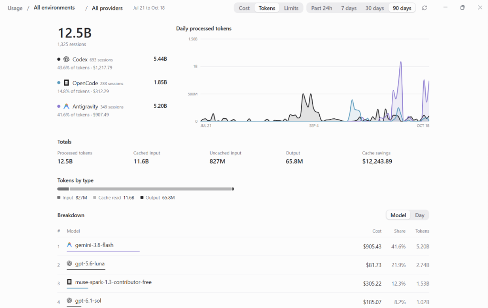

# 2
when scrolling down the main interface with tokens chosen. note the scroll bar on the right

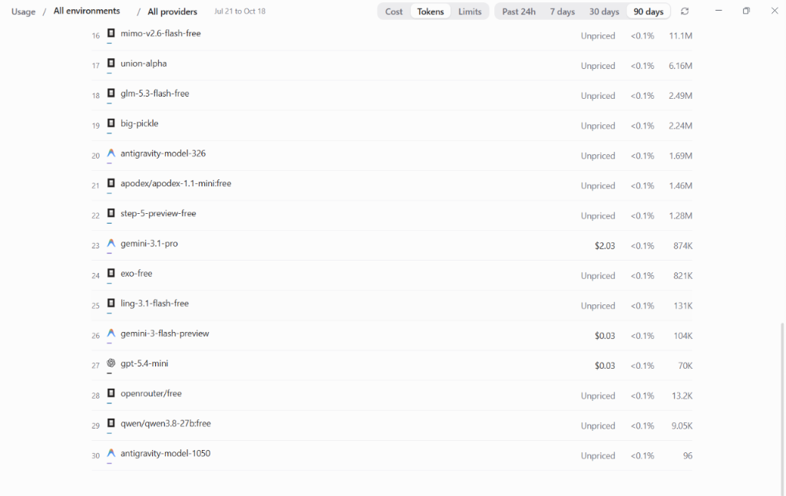

# 3
when clicking on one of the models in the horizontal chart and moving my mouse to the graph, with the hover window

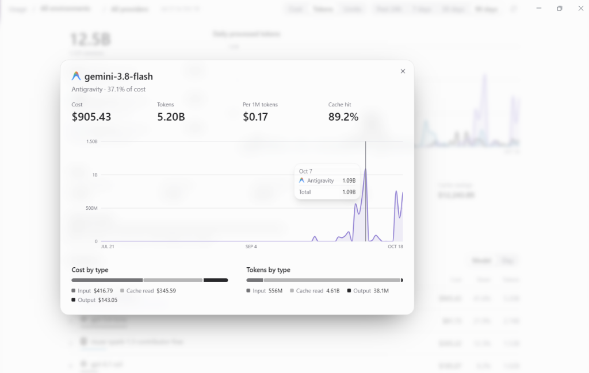

# 4
hover window on the main interface with tokens chosen graph

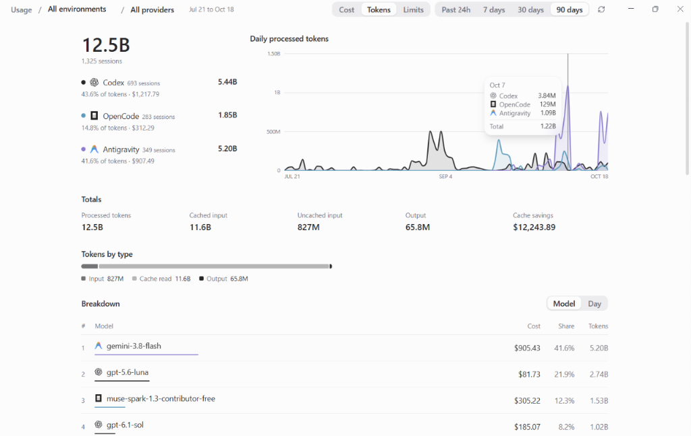

# 5
main interface with tokens chosen with "day" selected instead of model

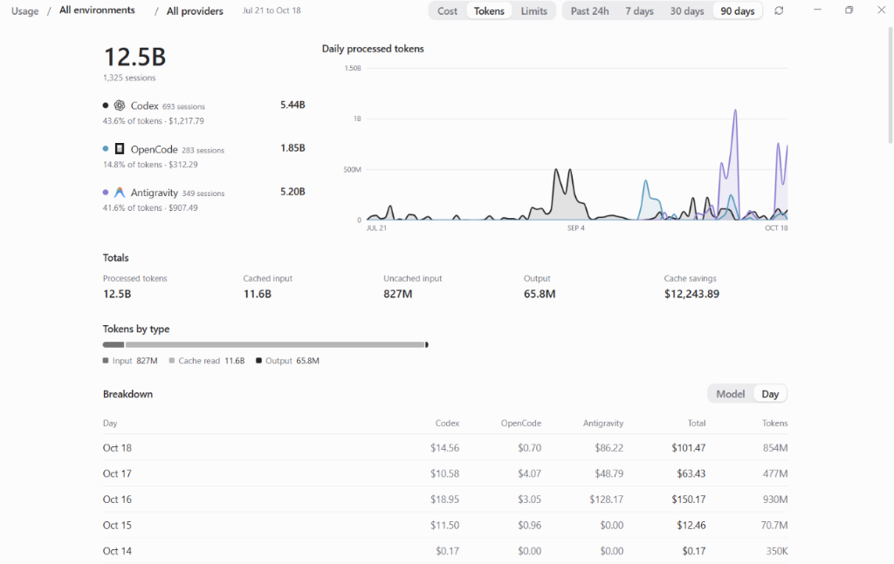

# 6
hover window on the main interface with cost chosen graph

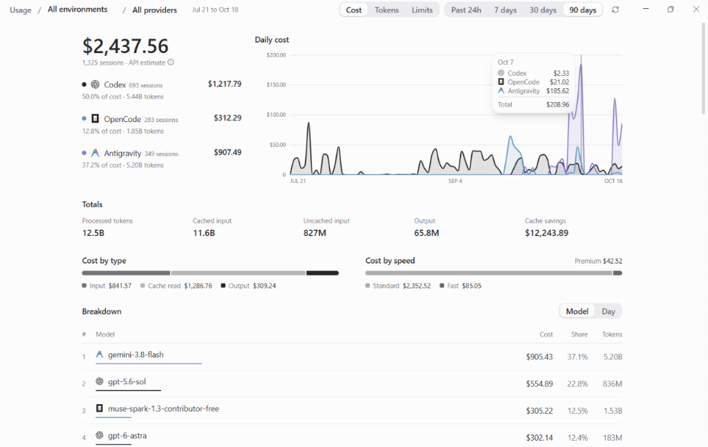

# 7
when clicking on one of the models in the horizontal chart and moving my mouse to the graph, with the hover window with cost chosen

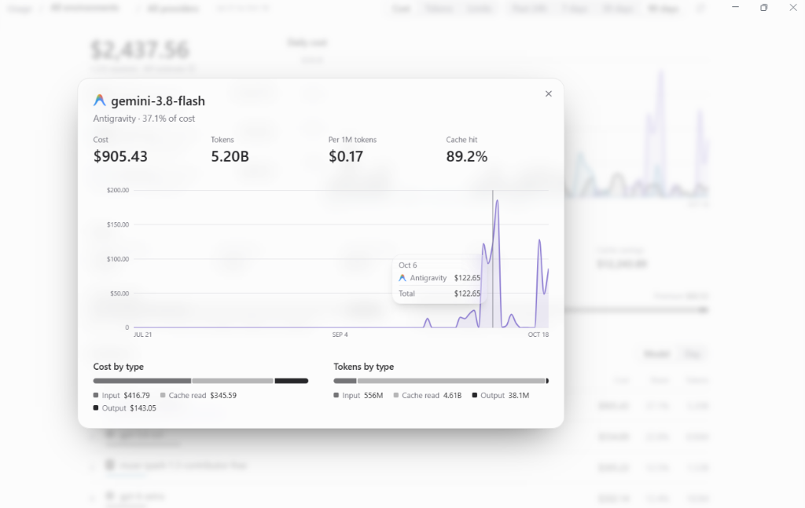

# 8
when scrolling down the main interface with cost chosen. note the scroll bar on the right

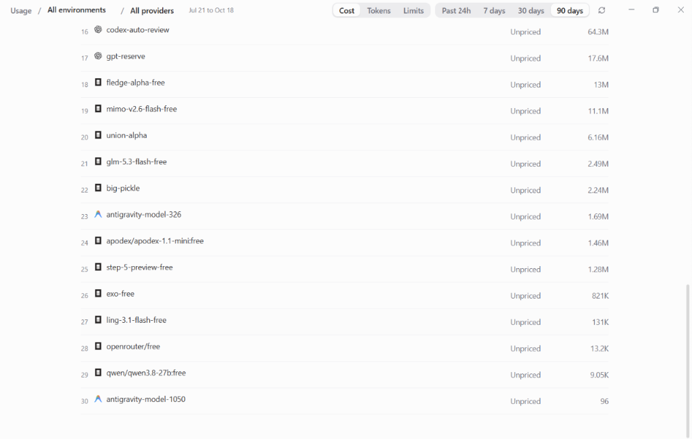

# 9
main interface with limits chosen. note the date window selection has gone grey and disabled

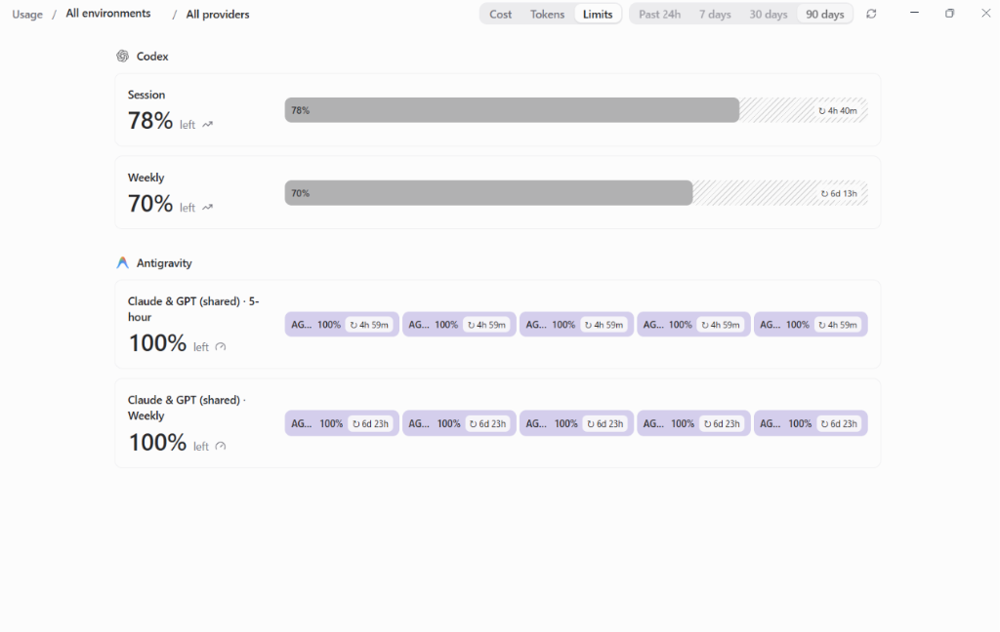

# 10
when clicking on an unpriced model in the horizontal chart and moving my mouse to the graph, with the hover window and set price button

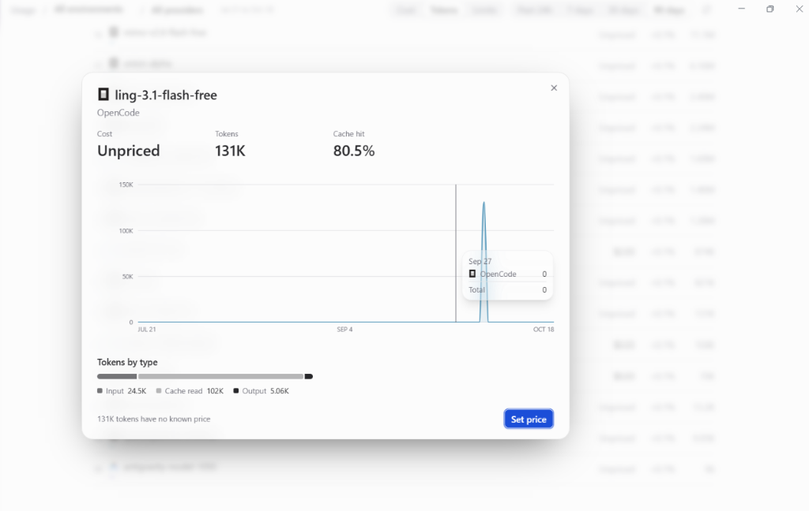

# 11
when clicking set price

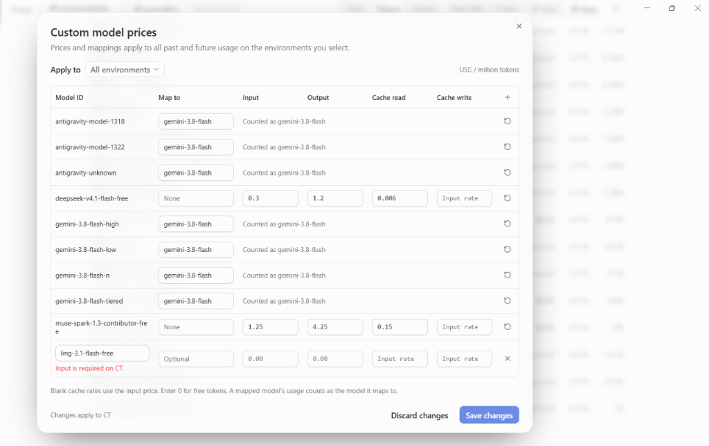
